_Kopieer en plak hier jouw README.md uit sprint 1._
Check out vragen 9 november Maandag

Sprint 0

### Check-out reflectie 

### Leg uit wat een source hosting platform is en voor welke jij gekozen hebt.

Een source hosting platform is een plek waar je de code van je website online kunt opslaan en delen. Ik heb gekozen voor GitHub. Hier kan ik mijn code bewaren en mijn aanpassingen bijhouden.

### Vertel welke domeinnaam jij gekozen hebt en hoe je die hebt gekoppeld aan jouw pagina.

Ik heb gekozen voor de naam Karo's Archive. Mijn website gaat over mijn eigen vinylcollectie. Ik wilde een naam die past bij een archief waarin ik mijn platen kan verzamelen en laten zien. Daarom heb ik voor Karo's Archive gekozen.

Ik heb geprobeerd mijn domeinnaam via GitHub te koppelen aan mijn website door de DNS instellingen te controleren. Dit is alleen nog niet helemaal gelukt.

### Beschrijf hoe je aanpassingen aan jouw pagina kunt maken en hoe je ervoor zorgt dat die op het web gepubliceerd worden.

Ik maak aanpassingen aan mijn website via VSCodium. Ik heb mijn GitHub gekoppeld door de HTTPS link te clonen. Als ik iets verander in mijn code, kan ik de aanpassingen synchroniseren met GitHub. Zo worden mijn nieuwste veranderingen opgeslagen en kan mijn website worden bijgewerkt. 

### S0 - Schetsen van o.a. interactie en animatie 

In de les zijn we aan de slag gegaan met schetsen. Hierbij heb ik lijnen, vierkanten en schermen geschetst. Ook al lijken de opdrachten makkelijk, er zit toch meer diepgang achter dan je in eerste instantie denkt. We hebben ook aan het Wok-menu gewerkt, maar omdat ik deze opdracht al eerder had gemaakt, wilde ik mijn aandacht vooral besteden aan de vorige opdrachten. Door de extra uitleg in de les heb ik nu een beter inzicht gekregen en begrijp ik beter wat de bedoeling is.

### Deepdive - Praktische CSS
In de les hebben we een lelijke pagina in HTML gemaakt. Hiervoor heb ik een bestaande code gebruikt en de opdracht stap voor stap gevolgd. Ik heb de structuur een beetje aangepast, omdat ik het zo overzichtelijker vond. Dit ging vrij makkelijk, omdat ik de basis nog kende van de vorige blokken. De pagina was expres lelijk gemaakt, zodat we deze later met de basis van HTML en CSS mooier kunnen maken.

 
 
 
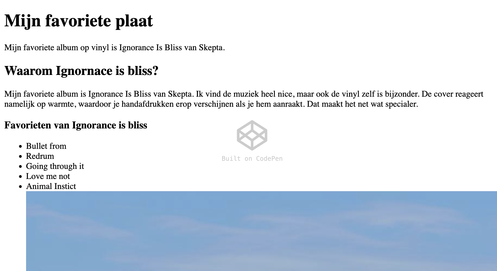 
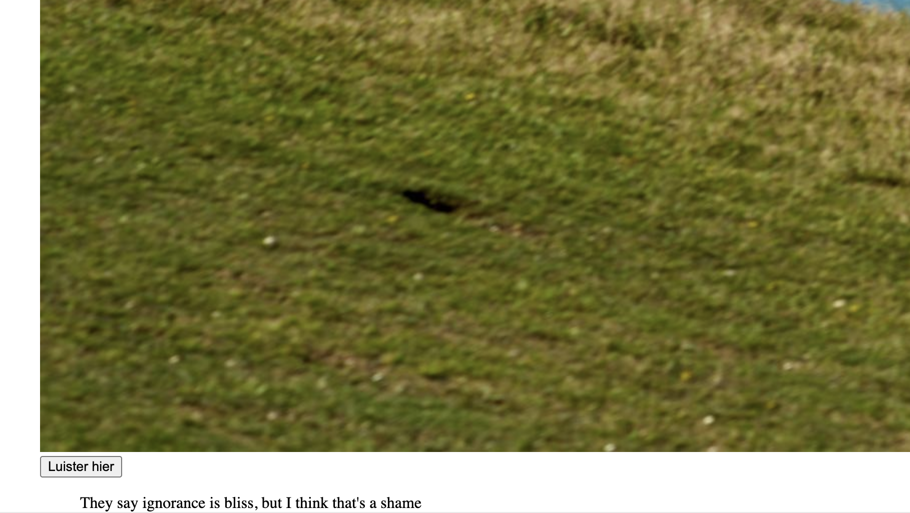 

Dit is hoe mijn pagina eerst eruitzag, tijdens de les ging ik stap voor stap mee om het mooier te maken met basis html en css. Hier heb ik geleerd hoe belangrijk spacing is, hover, kleur aangeven, andere font gebruiken en hoe je een form moet maken. 

(ik zie nu pas dat de screenshot niet goed opgeslagen is waarbij je mijn form ziet en mijn button maar heb het in de les wel gemaakt.) 

Ik heb ook met font veranderen gespeeld en dat kan je wel zien.

Ik vond het een fijne opdracht om de basis weer terug te oefenen.

### Deepdive - CSS: fonts met kleur en effecten 
Voor de voorbereiding moesten we eerst een stukje tekst namaken. Hierbij moesten we een lettertype toevoegen en de eerste letter van de tekst een andere kleur geven 

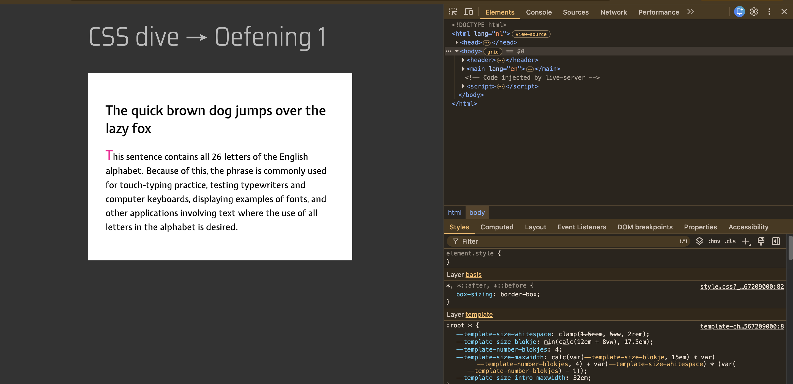
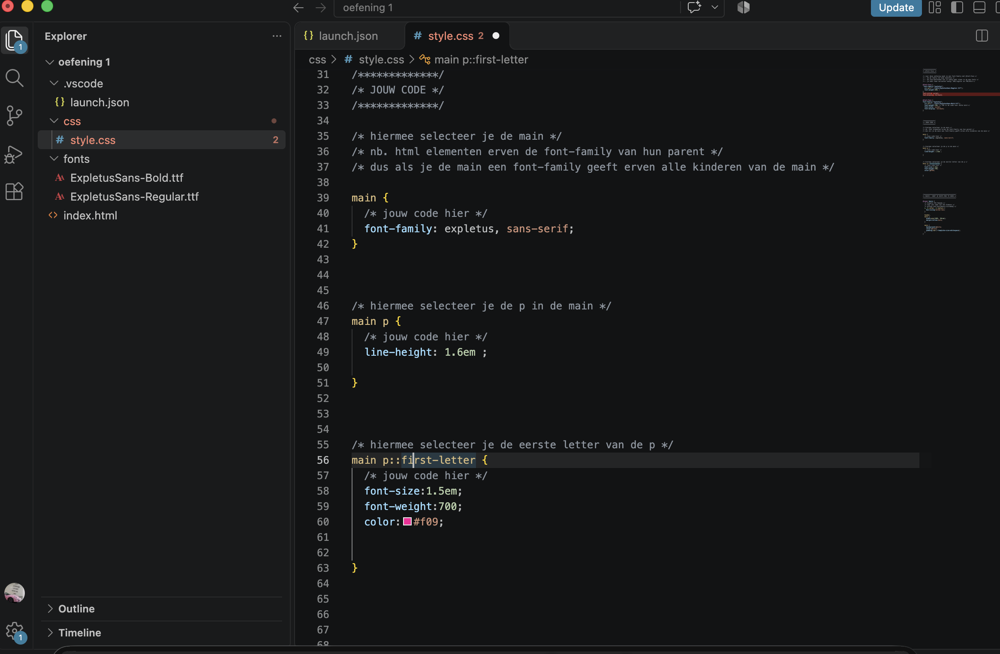

Daarna moesten we de CSS aanpassen om de twee posters zo veel mogelijk op de voorbeelden te laten lijken.
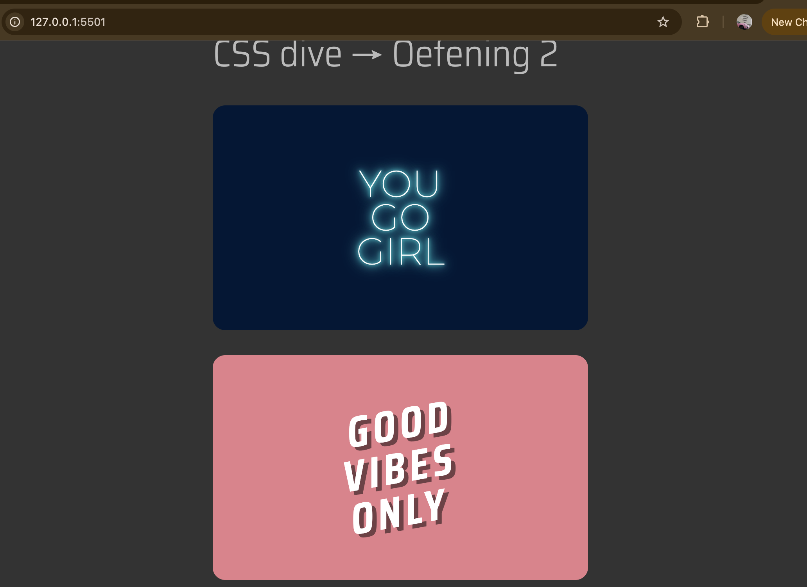

### Sprint 1
In de les hebben we gezamenlijk teksten gelezen en gekeken wat een digital garden eigenlijk is. 

Later in de les gingen we 2 websites analyseren en kijken welke het meest voldoet aan de voorwaarden. Iedereen had 2 websites en uit alle 8 gingen we er een uitkiezen Dit opdracht liet mij zien aan welke voorwaarden moet ik opletten. 

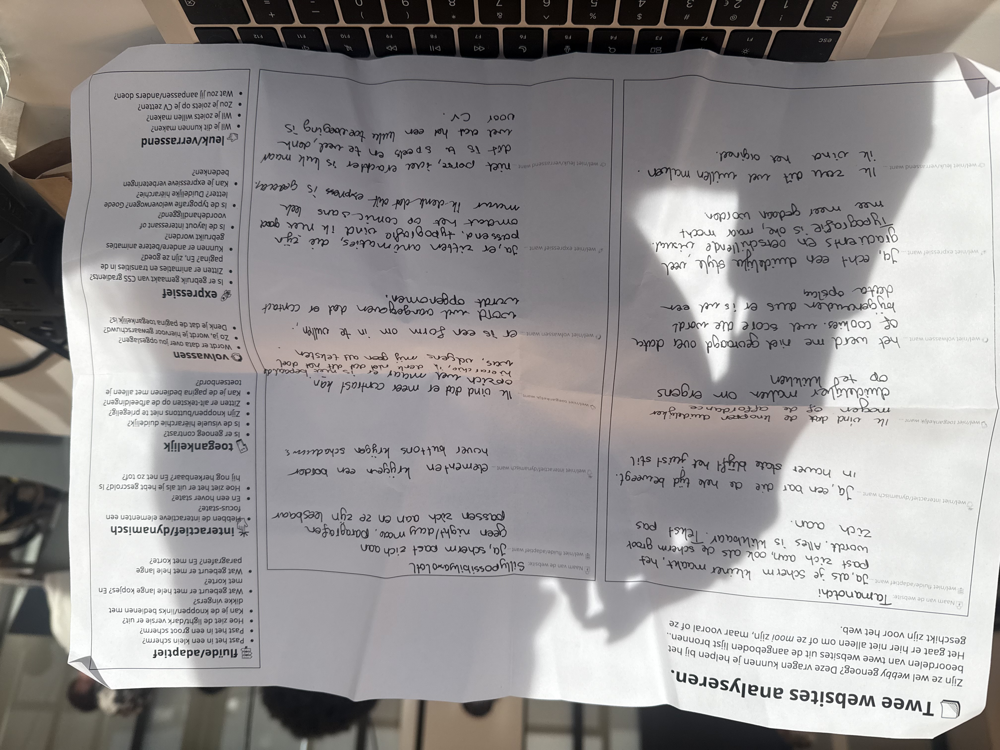

Uiteindelijk hebben we de website die Sam had gekozen uitgekozen. Die had het meeste voorwaarden. 

### Check out
Leg uit wat een digital garden is en waarom dat anders is dan een reguliere website.

Een digital garden is een website waar je je eigen ideeën en interesses kunt delen. Je kunt de inhoud steeds aanpassen en verbeteren. Ook kunnen anderen feedback geven. Het hoeft dus niet meteen perfect te zijn. Bij een normale website is alles meestal al uitgewerkt en staat de inhoud meer vast.

Leg uit wat een website 'webby' maakt en welke websites jou het meeste inspireren.

Een website is 'webby' als deze fluïde, adaptief, interactief, toegankelijk, volwassen, expressief en verrassend is. Ik vind websites vooral inspirerend als ze interactief, expressief en verrassend zijn. Ik vind het leuk als een website iets bijzonders heeft en je nieuwsgierig maakt om verder te kijken.

Vertel waar jij mee aan de slag wilt gaan bij het maken van jouw eigen digital garden (let op: dit zijn jouw eerste ideeën, dit kan en mag veranderen in de loop van het programma.)

Ik wil me focussen op vinylplaten en muziek. Muziek is een groot deel van mijn leven en ik vind het leuk om vinylplaten te verzamelen. Ik wil een plek maken waar ik mijn favoriete platen, albumcovers en artiesten kan delen. Ook wil ik vertellen waarom bepaalde albums mij aanspreken. Het lijkt me leuk om mijn website een eigen sfeer te geven en te experimenteren met kleuren, afbeeldingen en interactieve elementen.

### Voorbereiding presentatie

Ik heb 50 beelden verzameld die af en toe wel letterlijk zijn maar ook niet om die te kunnen presenteren en beetje het idee geven wat ik met mijn website wil uitstralen. Hierbij heb ik gekeken naar de kleuren, vormen, het vibe zelf en naar de typografie. Ook gewoon iets wat ik zelf aesthetic vind en zou misschien willen toepassen. 

Ik heb dit gedaan op pinterest https://nl.pinterest.com/sthkaro/karos-archive/ 
 
Ook wil ik inspiratie houden van de platen die ik thuis zelf heb en van mijn kamer omdat ik die estetisch vind en passend bij mijn onderwerp.

### Deepdive  Light & Dark theme 

Als opdracht moesten we zich verdiepen in light&dark theme. Door dit beter te begrijpen. 

### Visual research

Om beter idee te krijgen over de visual van mijn website heb ik een visual research gedaan. Ik moest het niet zo cliche houden en wat breder denken. Ik heb foto's onderzocht en gekeken wat ik wil mee uitstralen. 

Mijn gekozen sfeerwoorden: Dromerig, eigen, creatief, zelfsprekend 

Visual research te zien op: https://miro.com/app/board/uXjVEPuW9bg=/?share_link_id=478609892762 Naam Karolina. 

Ook heb ik vervolgens crazy8 gemaakt om mijn idee uit te werken en om idee te verzamelen. Ik pobeerde elke schets anders te houden zodat ik breder kon denken. 

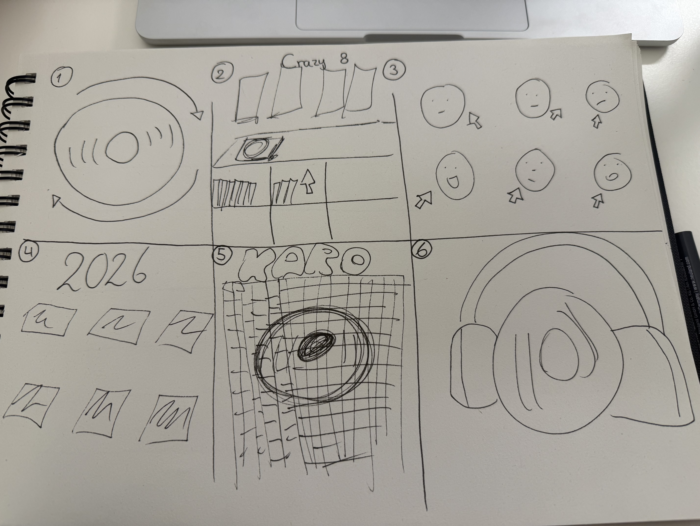
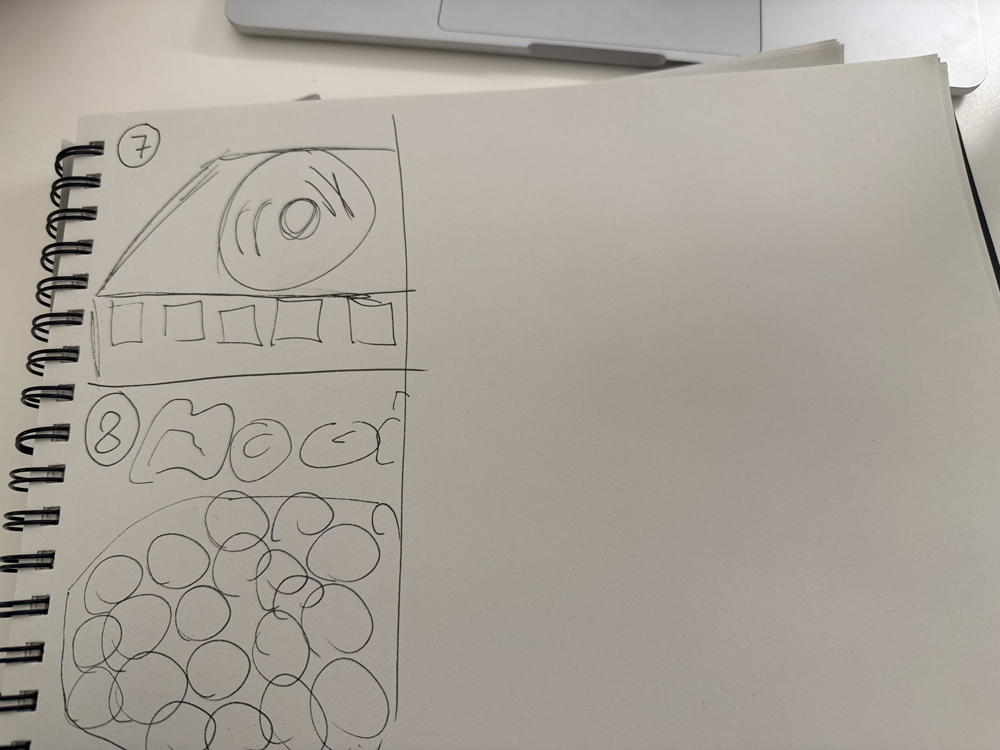

### Check out 

Leg uit waar het Visual Research in 3 stappen naartoe werkt

1 Eerst beschrijf je welk gevoel iets bij je oproept.

2 Daarna vertaal je dat gevoel naar een abstract beeld.

3 Als laatste gebruik je dit als inspiratie om zelf nieuwe ideeen te bedenken.

Vertel in 2 zinnen waar jouw Garden over gaat, en met welke content je dat gaat doen (beeld, tekst, sound, animatie enz).

Mijn Garden gaat over vinylplaten en muziek en hoe muziek bepaalde gevoelens en herinneringen kan oproepen. Ik wil dit laten zien met foto's van mijn platen, albumcovers, korte teksten en misschien ook geluid.

Vertel kort welk idee van de Crazy 8 je het liefst zou willen uitvoeren/ verder zou willen onderzoeken.

Ik zou het liefst het idee met de dvd speler en de discs verder willen onderzoeken. Het lijkt me leuk om te kijken hoe ik dit idee kan aanpassen naar vinylplaten en hoe ik dit op mijn website kan gebruiken. 

### Deepdive Kleuren & Gradients

Als opdracht hebben we gekregen om met gradients te oefenen ik heb dit opdracht uitgevoerd en heb nu een betere beeld hoe het gemaakt zou moeten worden. Hoogwaarschijnlijk wil ik ergens gradients gebruiken als toevoeging en om de website minder plat te maken. 

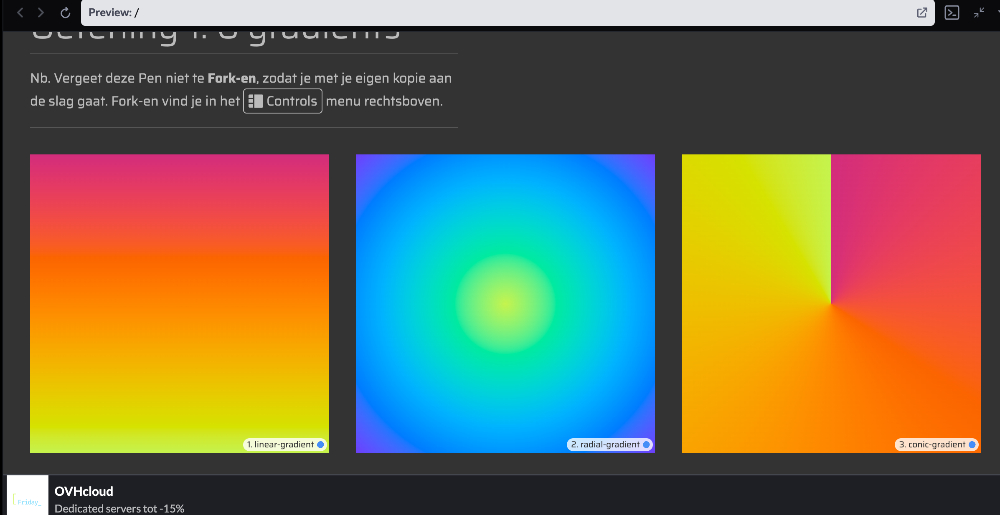
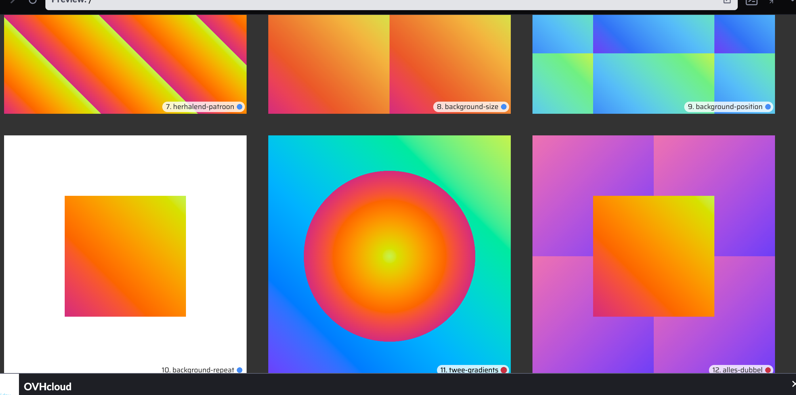
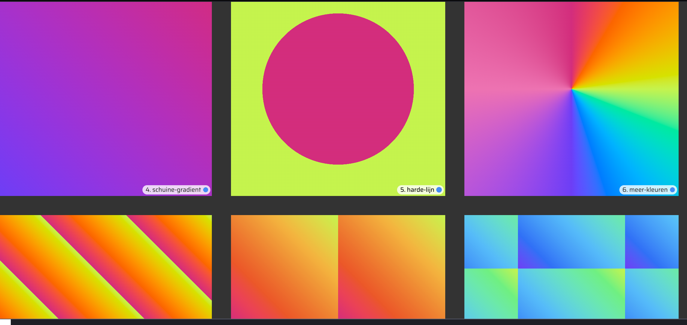

Vervolgens heb ik geoefend met de animaties met property. Dit vond ik nog best wel lastig. Ik zou wel aniamtie willen gebruiken in mijn website maar ik weet niet precies of het deze gaat zijn. 

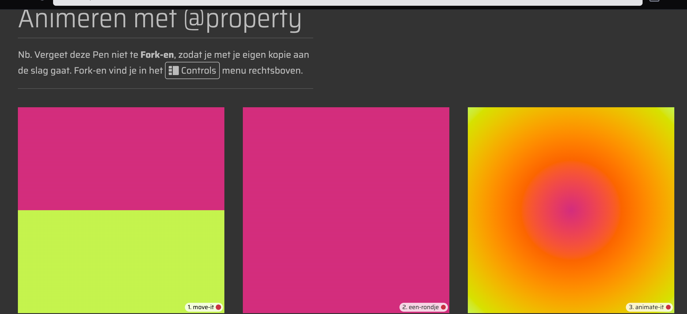
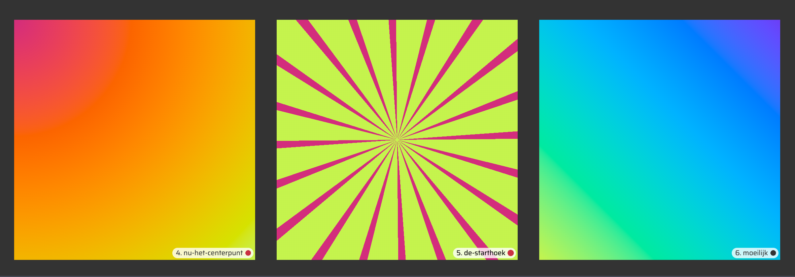

Ook heb ik geoefend met afbeelding responsive maken omdat het een belangrijke onderdeel is van een werkende pagina. 
Dit ga ik zeker toevoegen in mijn website. 

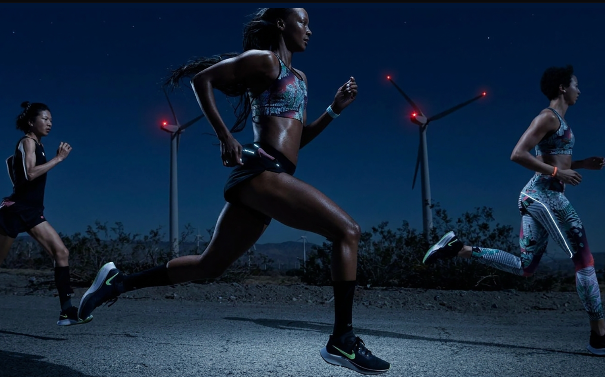
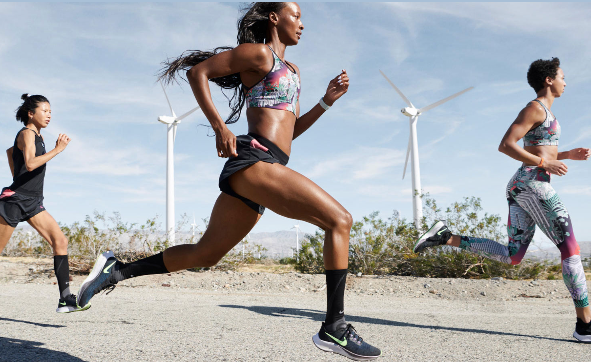 

###  Meet the properties Grid

Ik heb grid geoefend, ik heb niet alle opdrachten gedaan maar heb gekeken welke ik waarschijnlijk zou willen gebruiken en die heb ik toegepast. 

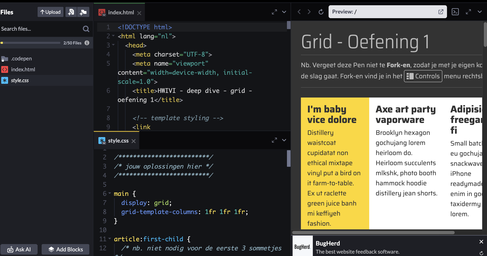
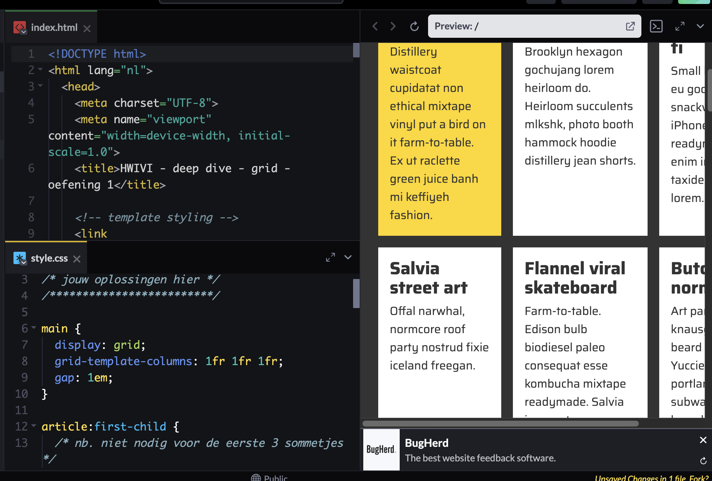
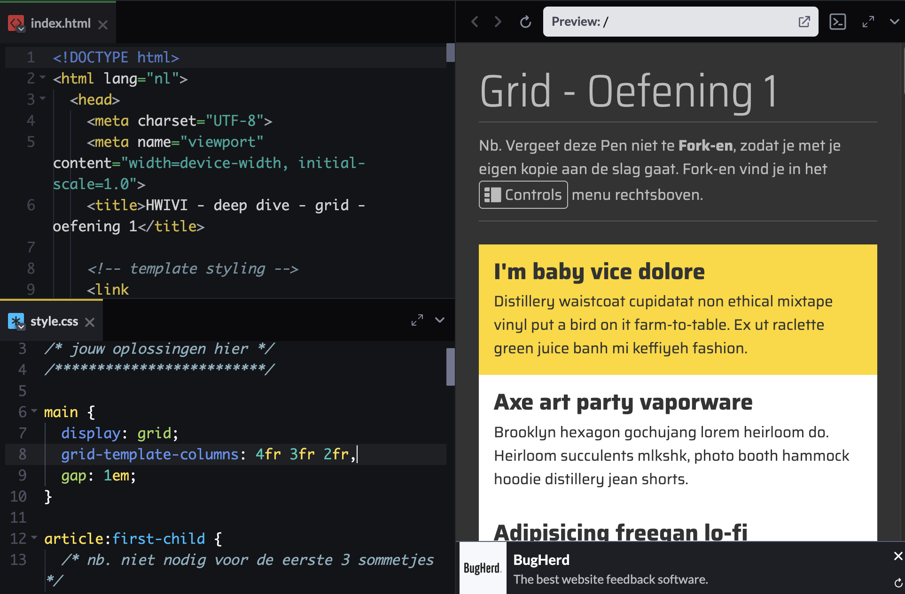
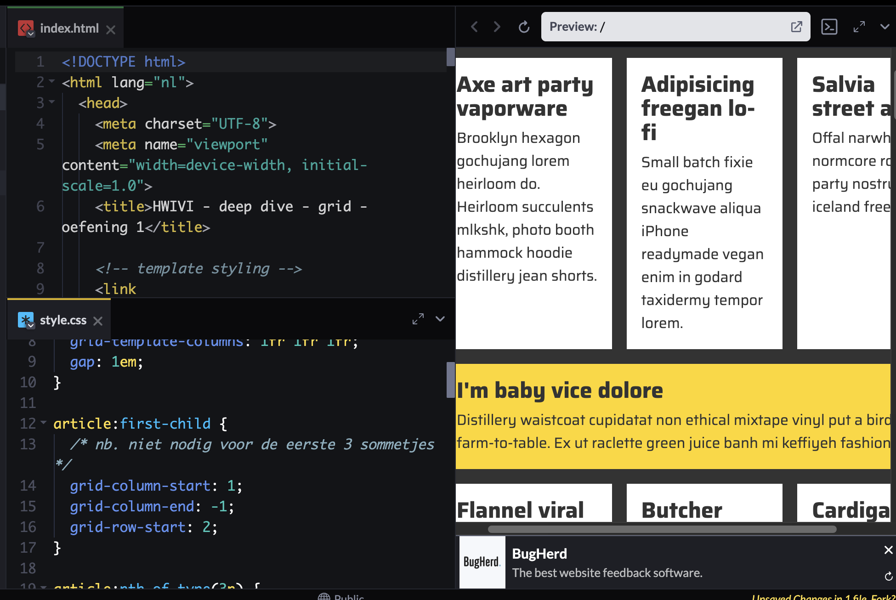

### Bi weekly geek 
In de klas hebben we gekeken wat eigenlijk internet is en daar paar stellingen over beantwoord. Vervolgens moesten we zelf vragen bedenken en een andere groepje moest die beantworden. 

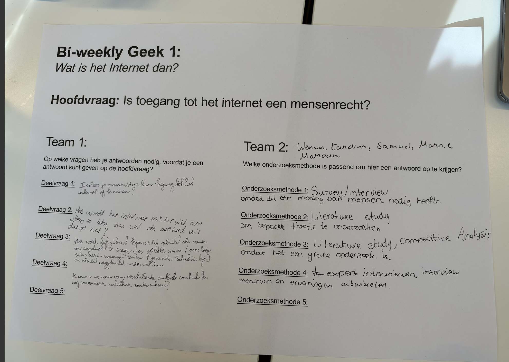
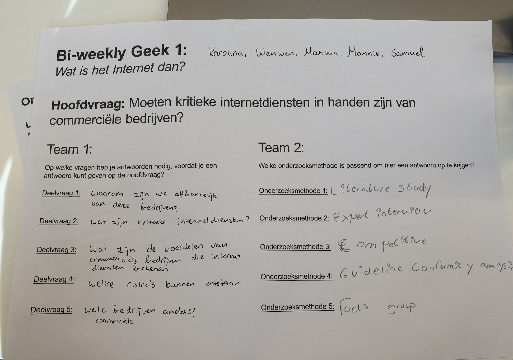

### Check out 
# Check-out

### Leg uit wanneer een website 'lelijk' wordt en geef voorbeelden wat je kan doen om deze 'lelijke' onderdelen te fixen?

Een website wordt lelijk als alles door elkaar staat en er weinig overzicht is. Bijvoorbeeld als kleuren niet bij elkaar passen, teksten te dicht op elkaar staan of afbeeldingen niet goed geplaatst zijn. Dit kun je verbeteren door meer ruimte te gebruiken, kleuren op elkaar af te stemmen en alles netjes te verdelen.

### Vertel welke volgende stap je neemt om je website responsive te maken.

Ik wil mijn website testen op verschillende schermen, zoals een laptop en telefoon. Daarna ga ik mijn CSS aanpassen zodat alles goed op het scherm past.

### Kun je het ontwerp en de bouw van je eigen Garden (zo uit je hoofd) onderbouwen in Webby vocabulaire?

Mijn Garden gaat over vinylplaten en muziek. Ik wil mijn website persoonlijk en creatief maken, met foto's van mijn platen en albumcovers. Ook wil ik experimenteren met kleuren en interactieve onderdelen. Mijn website moet makkelijk te gebruiken zijn en er goed uitzien op verschillende schermen.

### Continuatie Visual Research 

Op basis van mijn verzamelde ideeen heb ik een colorpalette gemaakt. HIk heb voor welle kleuren gekozen, hoogwaarschijnlijk als accenten kleuren. Ik heb rekening mee gehouden dat de website ook een dark&light mode moet hebben. Ik heb voor deze kleuren gekozen omdat ik persoonlijk vind dat ik ook een ''velle'' persoon ben en dit past bij mij en mijn onderwerp. 

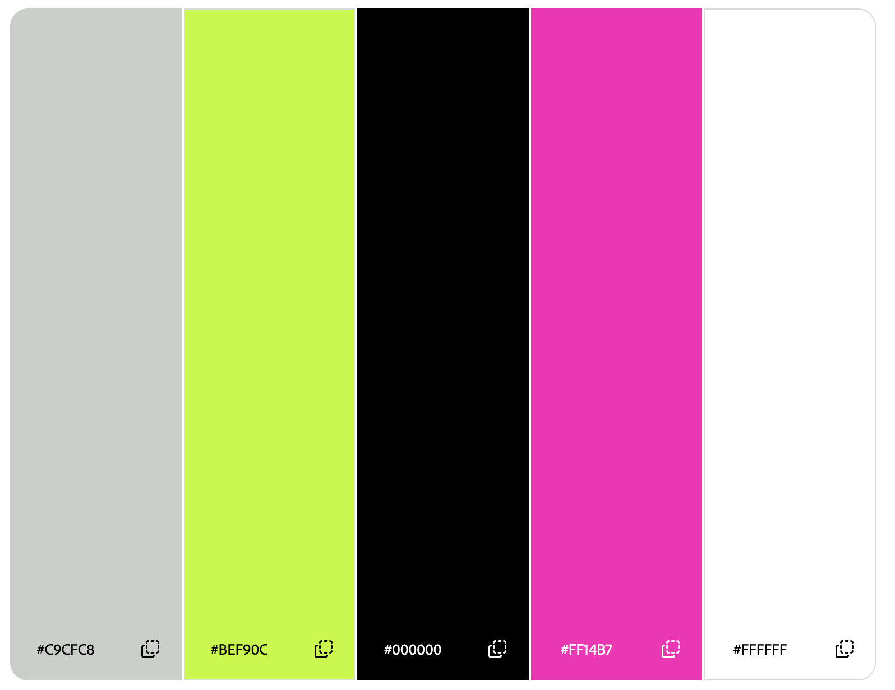 

Ik heb twee fonts gekozen die ik graag zou willen gebruiken. Als main/header font heb ik BlahBlah gekozen, omdat het een beetje speels en orgineel is en ik denk dat het bij mijn design gaat passen. Voor de overige teksten heb ik voor Seabass Variable gekozen, die is wat simpeler waardoor er balans is tussen de twee fonts. 

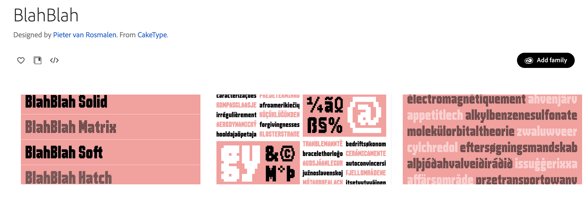
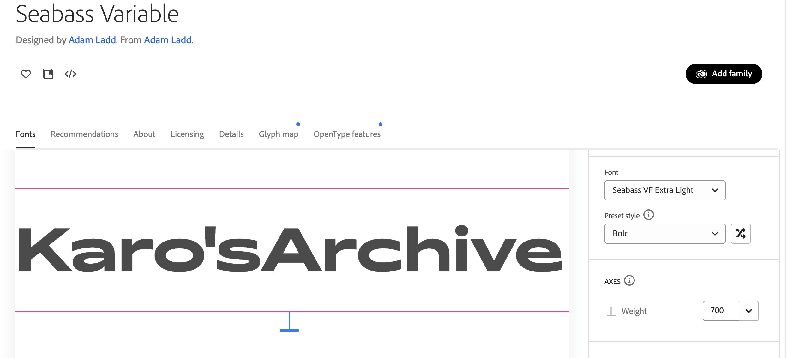 