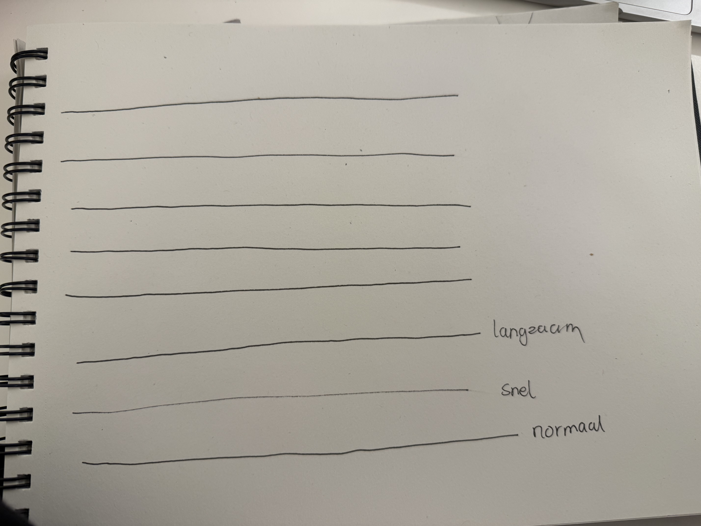
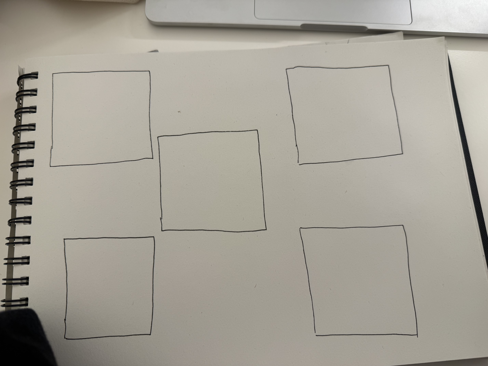
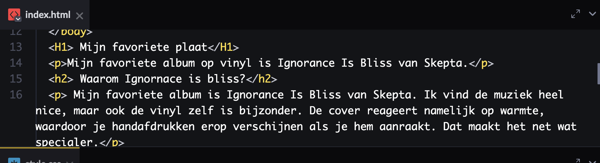
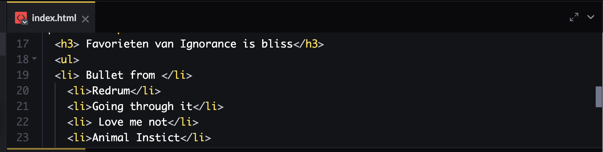
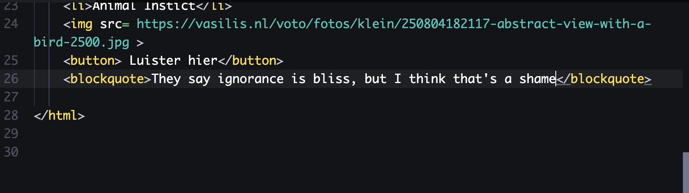

_Kopieer en plak hier jouw README.md uit sprint 1._
Check out vragen 9 november Maandag

Sprint 0

### Check-out reflectie 

### Leg uit wat een source hosting platform is en voor welke jij gekozen hebt.

Een source hosting platform is een plek waar je de code van je website online kunt opslaan en delen. Ik heb gekozen voor GitHub. Hier kan ik mijn code bewaren en mijn aanpassingen bijhouden.

### Vertel welke domeinnaam jij gekozen hebt en hoe je die hebt gekoppeld aan jouw pagina.

Ik heb gekozen voor de naam Karo's Archive. Mijn website gaat over mijn eigen vinylcollectie. Ik wilde een naam die past bij een archief waarin ik mijn platen kan verzamelen en laten zien. Daarom heb ik voor Karo's Archive gekozen.

Ik heb geprobeerd mijn domeinnaam via GitHub te koppelen aan mijn website door de DNS instellingen te controleren. Dit is alleen nog niet helemaal gelukt.

### Beschrijf hoe je aanpassingen aan jouw pagina kunt maken en hoe je ervoor zorgt dat die op het web gepubliceerd worden.

Ik maak aanpassingen aan mijn website via VSCodium. Ik heb mijn GitHub gekoppeld door de HTTPS link te clonen. Als ik iets verander in mijn code, kan ik de aanpassingen synchroniseren met GitHub. Zo worden mijn nieuwste veranderingen opgeslagen en kan mijn website worden bijgewerkt. 

### S0 - Schetsen van o.a. interactie en animatie 

In de les zijn we aan de slag gegaan met schetsen. Hierbij heb ik lijnen, vierkanten en schermen geschetst. Ook al lijken de opdrachten makkelijk, er zit toch meer diepgang achter dan je in eerste instantie denkt. We hebben ook aan het Wok-menu gewerkt, maar omdat ik deze opdracht al eerder had gemaakt, wilde ik mijn aandacht vooral besteden aan de vorige opdrachten. Door de extra uitleg in de les heb ik nu een beter inzicht gekregen en begrijp ik beter wat de bedoeling is.

### 1. Een lelijke HTML pagina maken

In de les hebben we een lelijke pagina in HTML gemaakt. Hiervoor heb ik een bestaande code gebruikt en de opdracht stap voor stap gevolgd. Ik heb de structuur een beetje aangepast, omdat ik het zo overzichtelijker vond. Dit ging vrij makkelijk, omdat ik de basis nog kende van de vorige blokken. De pagina was expres lelijk gemaakt, zodat we deze later met de basis van HTML en CSS mooier kunnen maken.

 
 
 
 
 

Dit is hoe mijn pagina eerst eruitzag, tijdens de les ging ik stap voor stap mee om het mooier te maken met basis html en css. Hier heb ik geleerd hoe belangrijk spacing is, hover, kleur aangeven, andere font gebruiken en hoe je een form moet maken. 

(ik zie nu pas dat de screenshot niet goed opgeslagen is waarbij je mijn form ziet en mijn button maar heb het in de les wel gemaakt.) 

Ik heb ook met font veranderen gespeeld en dat kan je wel zien.

Ik vond het een fijne opdracht om de basis weer terug te oefenen.

